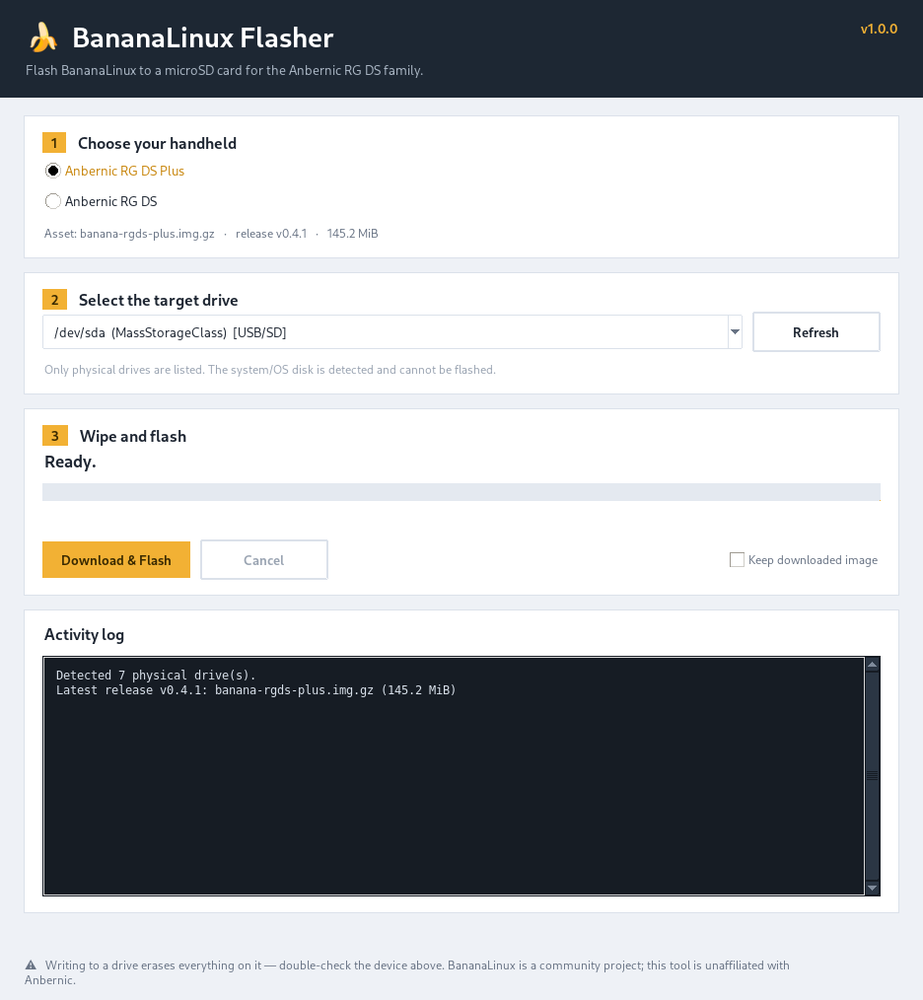

# 🍌 BananaLinux Flasher

[](https://github.com/jesussaves-ai/banana-linux-flasher/actions/workflows/build-exe.yml)

A small, dependency-free, cross-platform desktop app for flashing
[BananaLinux](https://github.com/JorreFog/BananaLinux) to a microSD card for the
**Anbernic RG DS** and **Anbernic RG DS Plus**.

It downloads the newest release straight from GitHub, safely wipes the card's
partition table, and streams the decompressed disk image directly to the raw
device. No BalenaEtcher, no Rufus, no extra tooling.



---

## ⬇️ Download for Windows (recommended)

**No Python required.** Grab the standalone `BananaLinuxFlasher.exe` from the
[latest GitHub Release](https://github.com/jesussaves-ai/banana-linux-flasher/releases/latest):

1. Open the **Assets** section and download **`BananaLinuxFlasher.exe`**.
2. Right-click the file → **Run as administrator** (flashing needs raw disk
   access; the app will also offer to elevate itself if you forget).
3. Pick your handheld, insert the microSD card, press **Refresh**, select the
   card, and press **Download & Flash**.

The `.exe` is a single self-contained file — Tkinter, the networking stack and
the icon are all bundled, so there is nothing else to install. It is built for
you by [GitHub Actions](.github/workflows/build-exe.yml) on every `v*` tag.

> Windows may show a SmartScreen notice for this unsigned community build.
> Choose **More info → Run anyway**.

## ⬇️ Download for Linux (AppImage)

**No Python required.** Grab `BananaLinuxFlasher-<version>-x86_64.AppImage`
from the [latest GitHub Release](https://github.com/jesussaves-ai/banana-linux-flasher/releases/latest):

```bash
chmod +x BananaLinuxFlasher-*-x86_64.AppImage
./BananaLinuxFlasher-*-x86_64.AppImage
```

The app asks for your `sudo` password in its own dialog when you start a flash
(raw device access needs root). It relies on the standard tools `sudo`, `dd`,
`lsblk`, `wipefs` and `findmnt`, which are present on virtually every desktop
distro. It is built by [GitHub Actions](.github/workflows/build-appimage.yml)
on every `v*` tag.

> macOS users: run from source (see below). No pre-built macOS binary is
> published.

---

## Features

**Polished Tkinter GUI**

* Dark header slab with a banana-amber accent and a single, cohesive colour theme
  shared by every control.
* Three numbered steps — *Choose your handheld → Select the target drive →
  Wipe and flash* — laid out as clean bordered cards.
* Platform-aware typography (picks SF Pro / Segoe UI / Inter / DejaVu Sans, and a
  matching monospace font for the log).
* Determinate progress bar that turns **green** on completion, plus an
  indeterminate sweep when the image size is unknown.
* Live status headline, a detail line showing bytes written, throughput and ETA.
* Built-in dark **activity log** with a matching scrollbar.
* Buttons and inputs disable themselves while a flash is running so you cannot
  start two operations at once.

**Dynamic GitHub release integration**

* Resolves the latest release and the correct asset for the selected model:
  * `banana-rgds-plus.img.gz` → Anbernic RG DS Plus
  * `banana-rgds.img.gz` → Anbernic RG DS
* Queries `…/releases/latest` first, then falls back to the release list
  (newest non-draft first) so it keeps working for **pre-release-only** repos —
  which is currently the case for BananaLinux upstream.
* Shows the resolved asset, release tag and download size before you commit.
* Streams the download with a progress bar and truncation detection.

**Safety first**

* Enumerates only physical drives and **never** offers the disk the OS boots
  from (Linux: root disk + any mounted disk; macOS: non-removable internal disks;
  Windows: the `%SystemDrive%` disk). Protected devices are labelled and refused.
* Optional **SHA-256 verification** against the release's `SHA256SUMS-*.txt`.
  On mismatch the card is left untouched.
* A destructive-action confirmation dialog before anything is written.

**Per-platform wiping**

| Platform | Wipe step |
| --- | --- |
| Linux | `sudo wipefs -a <device>` + zero the first 10 MB with `dd` + `sync` |
| Windows | `diskpart` script (`select disk N` / `attributes disk clear readonly` / `clean`) |
| macOS | `diskutil unmountDisk force` + `eraseDisk` |

**Direct streaming flasher**

The `.img.gz` is decompressed on the fly and piped straight to the raw block
device — nothing is ever written to an intermediate uncompressed file:

* **Linux** — pipes into `sudo dd of=/dev/sdX bs=4M conv=fsync`
* **macOS** — pipes into `sudo dd of=/dev/rdiskX bs=4m conv=fsync`, then ejects
* **Windows** — writes chunks to `\\.\PhysicalDriveN` via `CreateFileW` /
  `WriteFile` / `FlushFileBuffers`, retrying transient failures at the exact
  byte offset. Before writing it enumerates every volume on the target disk
  (`FindFirstVolumeW` + `IOCTL_VOLUME_GET_VOLUME_DISK_EXTENTS`), locks and
  force-dismounts each one (`FSCTL_LOCK_VOLUME` / `FSCTL_DISMOUNT_VOLUME`), and
  holds those locks until the flash finishes. Automatic volume mounting
  (`mountvol /N`) and the Shell Hardware Detection service are also paused for
  the duration and restored afterwards, so Windows cannot grab the freshly
  written Linux partitions mid-flash.

---

## Running from source (developers)

> Most users should use the **pre-built Windows executable** at the top of this
> page. The following instructions are for development and for Linux/macOS use.

### Requirements

* **Python 3.9 or newer** with **Tkinter** (ships with the official installers on
  Windows and macOS).
* **Elevated rights** for the wipe + write steps:
  * Linux / macOS — your `sudo` password (prompted once, then cached and kept
    alive for the duration of the flash)
  * Windows — Administrator (the app offers to relaunch itself elevated)
* An internet connection to reach the GitHub API.
* No third-party Python packages. Only the standard library is used.

#### Installing Tkinter

| Platform | Command |
| --- | --- |
| Debian / Ubuntu | `sudo apt install python3-tk` |
| Fedora | `sudo dnf install python3-tkinter` |
| Arch / Manjaro | `sudo pacman -S tk` |
| macOS (Homebrew Python) | `brew install python-tk` |
| Windows | Included with [python.org](https://www.python.org/downloads/) builds |

### Setup and running

```bash
git clone https://github.com/jesussaves-ai/banana-linux-flasher.git
cd banana-linux-flasher
```

There is nothing to install beyond Python and Tkinter:

```bash
# Linux / macOS
python3 flash_banana.py

# Windows (run as Administrator, or accept the elevation prompt)
python flash_banana.py
```

Then:

1. Pick your handheld (RG DS Plus or RG DS).
2. Insert the microSD card, press **Refresh**, and select it.
3. Press **Download & Flash** and confirm the warning.

If you start the app as root/Administrator directly, the password prompt is
skipped.

---

## Testing (no Windows PC required)

The Windows flashing path can't run natively on Linux, but its logic is
covered by tests that replace the `kernel32` / PowerShell / `mountvol`
boundary with in-memory fakes. This exercises the parts that actually break:
streaming offsets, short writes, retry-on-`ACCESS_DENIED`, and the
auto-mount guard's disable-then-always-restore contract.

```bash
python3 -m unittest discover -s tests -v
# or, if you have pytest:
python3 -m pytest tests -v
```

These run automatically on every push/PR via
[`.github/workflows/tests.yml`](.github/workflows/tests.yml).

> These tests validate the *logic*, not the real Win32 calls. Confirming the
> actual raw write and the "format this disk" fix still requires Wine or a real
> Windows machine with a spare card (the Windows `.exe` cannot be built from
> Linux — PyInstaller does not cross-compile).

---

## Building the Windows executable

The standalone `BananaLinuxFlasher.exe` is produced from
[`BananaLinuxFlasher.spec`](BananaLinuxFlasher.spec) — a **one-file, no-console**
PyInstaller build that bundles Tkinter, the icon and the standard-library
networking modules.

Build it locally (on Windows) with:

```powershell
python -m pip install pyinstaller
pyinstaller --clean --noconfirm BananaLinuxFlasher.spec
```

The binary is written to `dist\BananaLinuxFlasher.exe`. The same command is run
automatically by [`.github/workflows/build-exe.yml`](.github/workflows/build-exe.yml),
which triggers on `v*` tags and manual `workflow_dispatch`, uploads the executable
as a build artifact, and attaches it to the GitHub Release for tagged builds.

---

## Building the Linux AppImage

[`scripts/build_appimage.sh`](scripts/build_appimage.sh) builds the Linux binary
with PyInstaller, wraps it in an AppDir, and produces a portable AppImage with
[`appimagetool`](https://github.com/AppImage/appimagetool):

```bash
python3 -m pip install --user pyinstaller   # or use a venv
./scripts/build_appimage.sh
```

The result is written to `dist/BananaLinuxFlasher-<version>-<arch>.AppImage`.
The same script is run by
[`.github/workflows/build-appimage.yml`](.github/workflows/build-appimage.yml)
on every `v*` tag. `appimagetool` is downloaded automatically on first run, and
the build uses `--appimage-extract-and-run`, so it works without FUSE (containers
and CI included).

---

## How it works

1. **Resolve** — the latest GitHub release is queried and the matching `.img.gz`
   for your model is selected.
2. **Download** — the image is streamed to a temporary folder with progress.
3. **Verify** — the SHA-256 checksum is compared against the published
   `SHA256SUMS` file (when available).
4. **Wipe** — the partition table and leading sectors are erased using the
   platform's native mechanism.
5. **Flash** — the gzip stream is decompressed and written directly to the raw
   device, with progress, throughput and ETA.
6. **Finish** — the drive is synced (and ejected on macOS) and a completion
   dialog appears. It is then safe to remove the card.

---

## Troubleshooting

| Symptom | Cause / fix |
| --- | --- |
| *"No published release with assets was found"* | GitHub was unreachable or rate-limited. Wait a minute and retry. |
| Card does not appear in the list | Re-seat the reader, press **Refresh**; some USB readers only expose a device once media is inserted. |
| *"Refusing to flash the system disk"* | The selected drive is the OS/boot disk or holds mounted volumes — pick a different device. |
| *"Checksum mismatch"* | The download is corrupt or was tampered with. Nothing was written to the card; retry the download. |
| Windows: *"Could not open \\.\PhysicalDriveN"* | Another program is using the card, or the app is not elevated. Close Explorer windows and retry as Administrator. |
| Windows: *"You need to format the disk"* pop-up, followed by *"Write to \\.\PhysicalDriveN failed (Windows error 5)"* | Windows auto-mounted the new Linux partitions mid-write. The flasher now pauses automatic mounting and Shell Hardware Detection while writing, and retries transient `ACCESS_DENIED` errors, so this should no longer abort a flash. If it still occurs, dismiss the pop-up (never click **Format**) and retry. |
| Windows: SmartScreen blocks the `.exe` | The release is unsigned. Choose **More info → Run anyway**, or run from source. |
| macOS: card is busy | The tool unmounts the disk automatically; close any app (Finder, Disk Utility) holding it and retry. |
| Progress bar behaves oddly on huge images | Uncompressed images larger than 4 GiB exceed the gzip trailer value, so the bar switches to an indeterminate sweep. |

---

## Notes

* Writing an image **permanently destroys** everything already on the card.
  Double-check the selected device.
* This tool is unaffiliated with Anbernic. BananaLinux is a separate community
  project; upstream releases are currently published as pre-releases.
* Windows and macOS code paths are implemented against the documented system APIs
  but are best verified on the real OS before trusting them with a card.